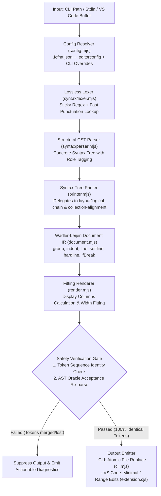

# FC Formatter v5 — Architecture & System Design

**FC Formatter v5** is a high-performance, deterministic, zero-dependency code formatter and language toolchain for the Craftland Code (FC) language (`.fcg`, `.fcc`).

---

## 1. Core Philosophy & Design Invariants

1. **Zero External Dependencies & Zero Build Step**:
   - Written in 100% Native ECMAScript Modules (`.mjs`). Runs directly on Node.js 20+ without `npm install`, compilation steps (`tsc`), or transpilers (`tsx`, `babel`).
   - Full static type safety is achieved through centralized JSDoc annotations and declaration files (`src/types/*.d.ts`) checked by IDE language services (`checkJs: true` in `jsconfig.json`).
2. **Wadler-Leijen Document Tree Model**:
   - The formatter never generates raw strings during AST traversal. It emits an immutable tree of layout instructions (`Doc`), decoupling syntax visitor traversal from line-wrapping width decisions.
3. **Defense-in-Depth Safety Guarantee**:
   - Formatting must never alter the semantics of valid game code. Every format operation undergoes a strict two-layer safety verification before any bytes are written to disk.
4. **Idempotence & Lossless Trivia Preservation**:
   - `format(format(code)) === format(code)`.
   - All comments, JSDoc blocks, trailing inline comments, and multiline raw string literals are preserved down to the exact byte.

---

## 2. End-to-End Pipeline & Data Flow



---

## 3. Subsystem Breakdown & Module Ownership

| Subsystem | Module | Responsibility & Key Implementation |
|---|---|---|
| **Syntax & Lexical** | [`src/syntax/lexer.mjs`](../src/syntax/lexer.mjs) | Lossless lexical tokenization, trivia tracking, comment categorization, protected byte spans. Optimized with sticky regex (`NUMBER_STICKY = /.../y`) and `PUNCTUATION_BY_FIRST` map. |
| | [`src/syntax/parser.mjs`](../src/syntax/parser.mjs) | Concrete Syntax Tree (CST) parser with role tagging, declaration headers, statement boundaries, virtual EOS (`NLSEMI`) handling, and syntax diagnostics. |
| | [`src/syntax/types.mjs`](../src/syntax/types.mjs) | Type reader for generics (`List<T>`, `Map<K, V>`), component types, function pointers, and parameter declarations. |
| | [`src/syntax/operators.mjs`](../src/syntax/operators.mjs) | Canonical tables of assignment, binary, prefix, shift, and postfix operators. |
| **Layout & Formatting** | [`src/printer.mjs`](../src/printer.mjs) | Traverses CST nodes and converts them into Wadler-Leijen `Doc` trees. Drives comment attachment, line break policies, and safety validation. |
| | [`src/layout/logical-chain.mjs`](../src/layout/logical-chain.mjs) | Isolated logic for operator precedence levels (`ARITHMETIC_PRECEDENCE`), condition group wrapping, and logical expression breaks (`&&`, `||`). |
| | [`src/layout/collection-alignment.mjs`](../src/layout/collection-alignment.mjs) | Column alignment algorithm for Map colons (`:`) and Struct assignments (`=`) using actual display columns (`columns()`) and conditional `ifBreak` padding. |
| **Document IR & Engine** | [`src/document.mjs`](../src/document.mjs) | Immutable Wadler-Leijen doc nodes: `text`, `line`, `softline`, `hardline`, `concat`, `group`, `indent`, `ifBreak`, `verbatim`. |
| | [`src/render.mjs`](../src/render.mjs) | Column fitting renderer. Measures string visual width with ASCII fast-path and Unicode character column width calculation. |
| **Performance & Diff** | [`src/cache.mjs`](../src/cache.mjs) | Persistent disk cache (`.fcfmtcache`) using atomic write. Combines SHA-1 content hash, file size, `mtimeMs`, version, and configuration leaves hash. |
| | [`src/diff.mjs`](../src/diff.mjs) | Zero-dependency Myers line-level diffing algorithm with common prefix/suffix optimization (`computeLineHunks`) and unified diff generator. |
| **Services & Tooling** | [`src/service.mjs`](../src/service.mjs) | Headless formatting service shared between CLI and editor adapters. Resolves effective configuration and manages ignore status. |
| | [`src/config.mjs`](../src/config.mjs) | Discovery of `.fcfmt.json`, `.editorconfig`, and `.fcfmtignore`. Implements cascading precedence, glob pattern overrides, and provenance tracking. |
| | [`src/config-registry.mjs`](../src/config-registry.mjs) | Single source of truth for all formatting options, defaults, validators, and CLI mappings. Powers automated schema generation. |
| | [`bin/fcfmt.mjs`](../bin/fcfmt.mjs) / [`src/cli.mjs`](../src/cli.mjs) | Command-line interface with atomic batch preflight verification, sibling temporary file commit, and `--cache` integration. |
| | [`extension/src/extension.cjs`](../extension/src/extension.cjs) | VS Code extension adapter providing Document Formatting (`Shift+Alt+F`), Range Formatting (`Ctrl+K, Ctrl+F`), in-memory config caching, and file watchers. |

---

## 4. Defense-in-Depth Safety Architecture

To guarantee that the formatter never silently introduces syntax drift or loses code comments, v5 uses two independent validation layers:

```text
Input Source  ───────────────────────────────┐
      │                                       │
      ▼                                       ▼
1. Lossless Lexing                      Re-lex Output
      │                                       │
      ▼                                       ▼
  Original Tokens ═════════════════════► Output Tokens
  (Kind, Text, Position)               (Kind, Text)
                                              │
                            [Layer 1: Token Identity Check]
                            - Every code token must match 1-to-1
                            - Every comment must be preserved
                            - No token merging (e.g. + + into ++)
                                              │
                                              ▼
                            [Layer 2: AST Oracle Acceptance]
                            - Output parsed through CST parser
                            - Output tested against gcc/fccompile
```

1. **Layer 1: Token Sequence Identity**:
   - After formatting, the output text is immediately re-lexed.
   - The sequence of non-trivia tokens (`codeTokens`) must match the original token stream item-for-item in both `kind` and `text`.
   - Every comment token in the input must be accounted for in the output.
   - If any token is missing, mutated, or merged (e.g. two separate `+` tokens collapsing into `++`), the formatted output is discarded and an error diagnostic is raised.
2. **Layer 2: AST Oracle Acceptance Gate**:
   - The output is re-parsed through the structural parser and verified against the Craftland Studio ANTLR grammar bundle (`craftlandstudio.ffugclanguage-1.11.0`).
   - In automated test gates, formatted fixtures are passed directly to the real Craftland compiler executable (`fccompile.exe`).

---

## 5. The Wadler-Leijen Layout Engine

Unlike traditional formatters that use imperative token writers with mutating column stacks, v5 builds an intermediate representation (IR) using algebraic document combinators:

- **`text(content)`**: Atomic text string that cannot be broken.
- **`line`**: A newline when broken; a single space when flattened inside a fitting group.
- **`softline`**: A newline when broken; empty string `""` when flattened.
- **`hardline`**: An unconditional newline that forces its enclosing groups to break.
- **`group(doc)`**: Tells the renderer to try fitting `doc` on a single line within `printWidth`. If it fits, all interior `line` nodes become spaces. If it exceeds `printWidth`, the group breaks and all `line` nodes become newlines.
- **`indent(doc)`**: Indents all broken lines inside `doc` by the configured indent size.
- **`ifBreak(brokenDoc, flatDoc)`**: Conditional branching node that renders `brokenDoc` if the enclosing group broke, or `flatDoc` if it fit on a single line (used for trailing commas, matrix separator padding, and statement closes).

---

## 6. Range Formatting Architecture

When a developer formats a selection (`Ctrl+K, Ctrl+F`), `fc-format-v5` uses **Full-Context Line-Bound Slicing**:

1. The entire document is formatted in memory in full context (`< 3ms`). This guarantees that all scope levels, parent indentations, and block braces are 100% syntactically correct.
2. The Myers diff algorithm in [`src/diff.mjs`](../src/diff.mjs) compares the original lines against the formatted lines to compute isolated `LineHunk` blocks.
3. The extension expands the user's selected range to full line bounds and filters only the hunks that intersect with the selection.
4. Only the intersecting hunks are converted into `vscode.TextEdit` replacements. Lines outside the selection remain completely untouched.
