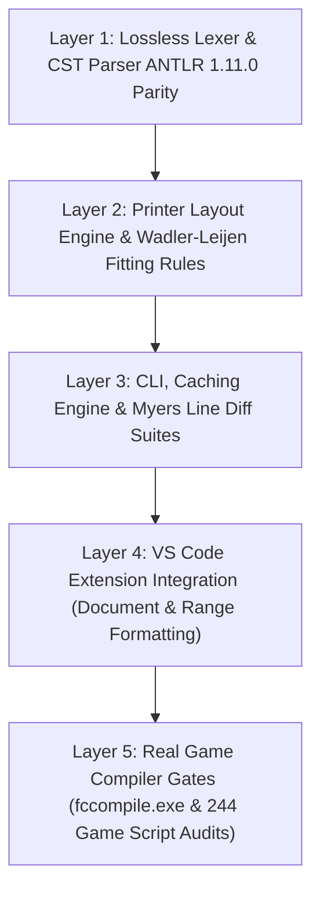

# FC Formatter v5 — Testing & Verification Handbook

This document outlines the testing architecture, quality gates, regression verification suites, and compiler audit tools for **FC Formatter v5**.

The test framework is built entirely on Node.js native test runner (`node:test`) and strict assertions (`node:assert/strict`), requiring zero npm test dependencies.

---

## 1. The 5-Layer Verification Pyramid

All changes to the formatter pass through a multi-tiered verification pipeline consisting of **227 automated test cases**:



| Layer | Focus Area | Test Suites | What It Proves |
|---|---|---|---|
| **1. Syntax & Grammar** | CST Parser, Lexer, Token Spans | `tests/syntax-phase2.test.mjs`<br>`tests/grammar-matrix.test.mjs`<br>`tests/grammar-oracle.test.mjs`<br>`tests/trivia-safety.test.mjs` | Proves 100% grammar parity with Craftland Studio extension 1.11.0 across all 124 rules. Verifies that virtual EOS (`NLSEMI`) and trivia boundaries are lossless. |
| **2. Layout & Formatting** | Wadler-Leijen IR, Break Rules | `tests/printer-phase3.test.mjs`<br>`tests/layout-regressions.test.mjs`<br>`tests/logical-layout.test.mjs`<br>`tests/collection-alignment.test.mjs`<br>`tests/operator-spacing.test.mjs`<br>`tests/style-parity.test.mjs` | Verifies that operators, logical condition chains, struct assignments, map colons, call arguments, and block indentation reflow idempotently without syntax distortion. |
| **3. CLI & Performance** | CLI Modes, Caching, Diffing | `tests/cli-phase4.test.mjs`<br>`tests/cache.test.mjs`<br>`tests/diff.test.mjs` | Validates `--check`, `--diff`, `--write`, `--cache` (metadata & content hashing), atomic sibling temporary file commits, and Myers line hunk calculations. |
| **4. Editor Integration** | VS Code Extension Adapter | `tests/extension-phase5.test.mjs` | Tests Document Formatting (`Shift+Alt+F`), Range Formatting (`Ctrl+K, Ctrl+F`), in-memory config caching, file watcher invalidation, and CRLF safety. |
| **5. Compiler Gates** | Real `fccompile.exe` Execution | `scripts/probe-compiler.mjs`<br>`scripts/audit-rollout.mjs` | Passes isolated formatted code directly into Craftland Studio's production compiler executable, and dry-runs on 244 real game scripts under `Assets/Scripts`. |

---

## 2. Command Reference

### Running Standard Test Suites
```sh
# Run all 227 tests
npm test

# Run syntax and grammar oracle tests
npm run test:syntax

# Run printer layout and formatting tests
npm run test:printer

# Run CLI argument, diff, and write tests
npm run test:cli

# Run VS Code extension adapter tests
npm run test:extension

# Run cache unit and e2e integration tests
node --test tests/cache.test.mjs

# Run Myers line-diff unit tests
node --test tests/diff.test.mjs
```

### Running Real Compiler Gates & Probes
```sh
# Compile 34 raw fixtures through fccompile.exe
npm run probe:compiler

# Compile 25 formatted fixtures through fccompile.exe
npm run probe:compiler:formatted

# Scan and dry-run format 244 game scripts under Assets/Scripts
npm run audit:rollout

# Run performance benchmark on large file (BigNumber.fcg - 88.5 KB)
npm run bench:printer

# Verify that schema.json, config.d.ts and docs match registry
npm run config:check
```

---

## 3. Defense-in-Depth Verification Invariants

Every format operation must pass two non-negotiable safety checks before any file on disk is modified:

### Check 1: Token Sequence Identity
The output is re-lexed and compared with the input:
- `originalCodeTokens.length === outputCodeTokens.length`
- For each token index $i$: `originalCodeTokens[i].kind === outputCodeTokens[i].kind && originalCodeTokens[i].text === outputCodeTokens[i].text`.
- Every comment token in the input must exist in the output with matching text.

### Check 2: Idempotence Verification
For any valid FC source code $S$:
$$\text{format}(\text{format}(S)) \equiv \text{format}(S)$$
A format operation must reach a stable fixed point in a single pass. The automated corpus test formats all 244 project scripts, re-formats the outputs, and asserts 0 byte diff.

---

## 4. Performance Benchmarks

Performance is measured continuously on [`Assets/Scripts/Utils/BigNumber.fcg`](file:///d:/Craftland%20Projects/PlantsVsZombiesFCC/Assets/Scripts/Utils/BigNumber.fcg) (88.5 KB, 3000+ lines):

| Optimization Milestone | Median Duration (10 Runs) | Improvement |
|---|---|---|
| **Base v5 (Baseline)** | ~400 ms | - |
| **Sticky Regex + ASCII Fast-Path** | **293.4 ms** | **~26% faster** |
| **CLI `--cache` (Warm Hit)** | **< 30 ms** | **~90% faster** |

To reproduce benchmark measurements:
```sh
npm run bench:printer
```
